# Dokumentasi Sistem POS Mutiara Tani

Dokumentasi ini disusun berdasarkan kode aplikasi PHP pada proyek. Sistem merupakan aplikasi POS/kasir untuk mengelola produk, kategori, transaksi penjualan, laporan, stok kosong, analisis market basket, dan akun pengguna.

## 1. Keterangan Sistem

Nama sistem: Sistem POS Mutiara Tani / Audri POS

Tujuan sistem:
- Membantu proses penjualan di toko secara cepat.
- Mengelola data produk, kategori, harga, dan stok.
- Mencatat transaksi penjualan beserta detail barang yang dibeli.
- Mengurangi stok secara otomatis setelah transaksi berhasil.
- Menyediakan laporan total transaksi, total penjualan, stok kosong, transaksi terbaru, dan pasangan barang yang sering dibeli bersama.
- Mengelola akun pengguna untuk admin dan pekerja.

## 2. Aktor Sistem

| Aktor | Keterangan |
|---|---|
| Admin | Pengguna dengan akses penuh, termasuk mengelola user. |
| Pekerja | Pengguna operasional yang dapat login, mengelola produk, memproses transaksi, melihat dashboard, dan melihat laporan. |

Catatan: Pada kode, halaman `users.php` hanya dapat diakses oleh role `admin`, sedangkan halaman dashboard, produk, transaksi, dan laporan dapat diakses oleh user yang sudah login.

## 3. Use Case

### Daftar Use Case

| Kode | Use Case | Aktor | Keterangan |
|---|---|---|---|
| UC-01 | Login | Admin, Pekerja | Pengguna memasukkan username dan password untuk masuk sistem. |
| UC-02 | Logout | Admin, Pekerja | Pengguna keluar dari sesi sistem. |
| UC-03 | Melihat Dashboard | Admin, Pekerja | Pengguna melihat ringkasan stok kosong/habis dan akses cepat transaksi. |
| UC-04 | Mengelola Produk | Admin, Pekerja | Pengguna menambah, mengubah, menghapus, melihat produk, serta mengedit harga dan stok langsung dari tabel. |
| UC-05 | Mengelola Kategori | Admin, Pekerja | Pengguna menambah, melihat, dan menghapus kategori. |
| UC-06 | Memproses Transaksi | Admin, Pekerja | Pengguna memilih produk, memasukkan jumlah, memproses penjualan, dan stok berkurang otomatis. |
| UC-07 | Melihat Transaksi Terbaru | Admin, Pekerja | Pengguna melihat 10 transaksi terbaru. |
| UC-08 | Mencetak Nota | Admin, Pekerja | Pengguna mencetak nota berdasarkan ID transaksi. |
| UC-09 | Melihat Laporan | Admin, Pekerja | Pengguna melihat total transaksi, total penjualan, total produk, stok kosong, grafik top 10 barang terbanyak dibeli, dan analisis pasangan barang. |
| UC-10 | Mengelola User | Admin | Admin menambah, mengubah, menghapus user, serta mengubah password. |

### Diagram Use Case

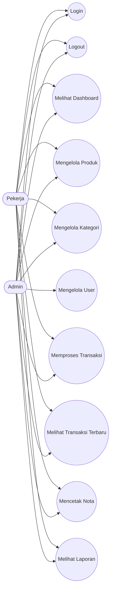

## 4. ERD

Relasi utama:
- Satu kategori dapat memiliki banyak produk.
- Satu produk dapat muncul pada banyak detail transaksi.
- Satu transaksi memiliki banyak detail transaksi.
- User dipakai untuk autentikasi dan hak akses sistem.

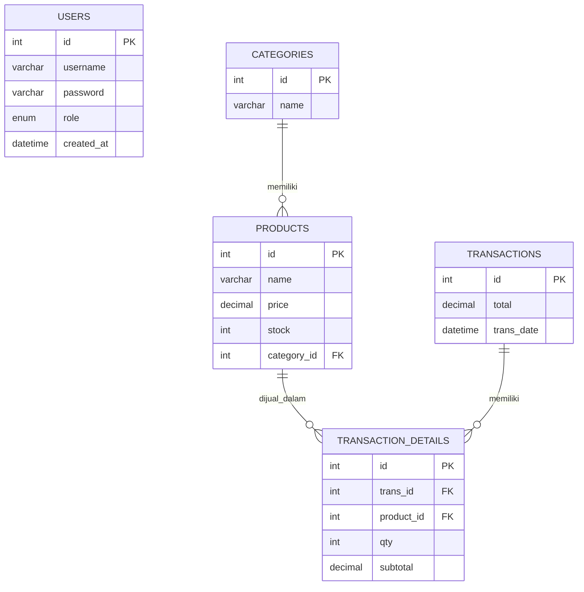

## 5. Activity Diagram

### Activity Diagram Login

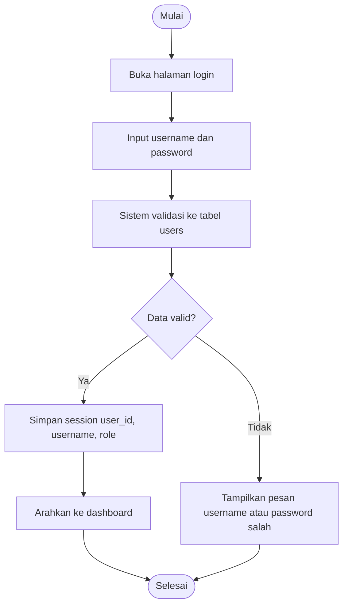

### Activity Diagram Transaksi Penjualan

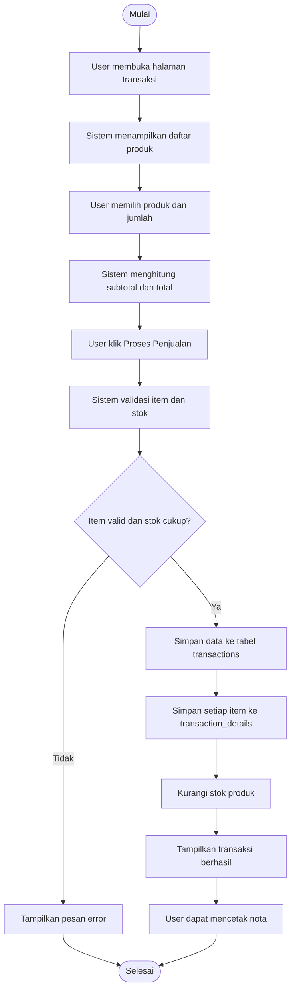

### Activity Diagram Kelola Produk

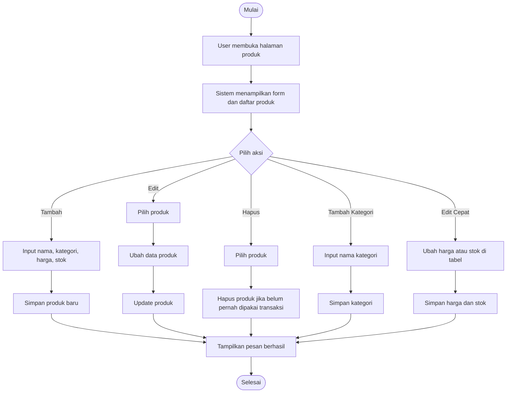

### Activity Diagram Laporan

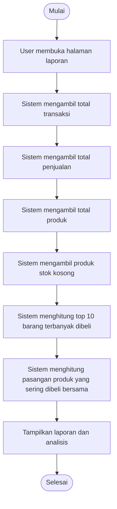

## 6. Sequence Diagram

### Sequence Diagram Login

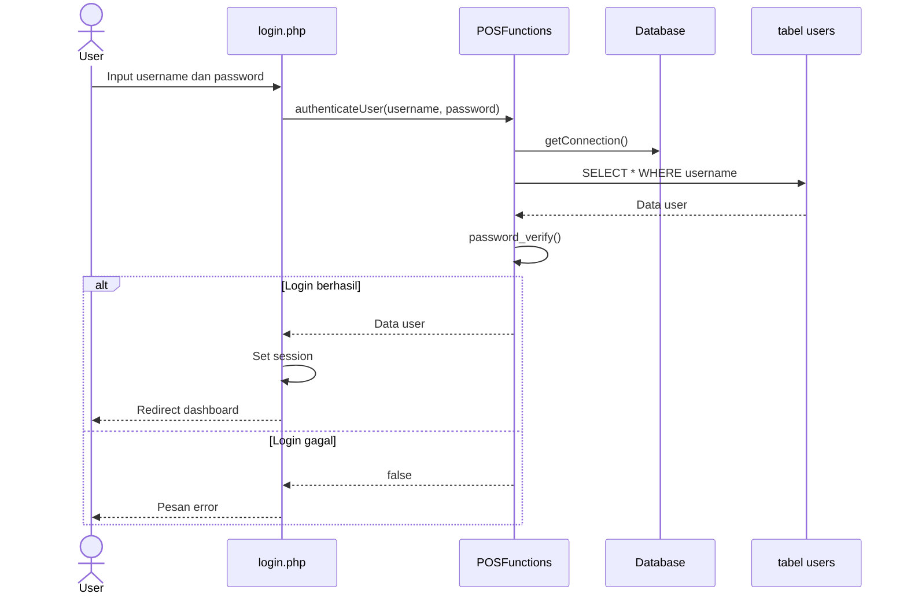

### Sequence Diagram Transaksi Penjualan

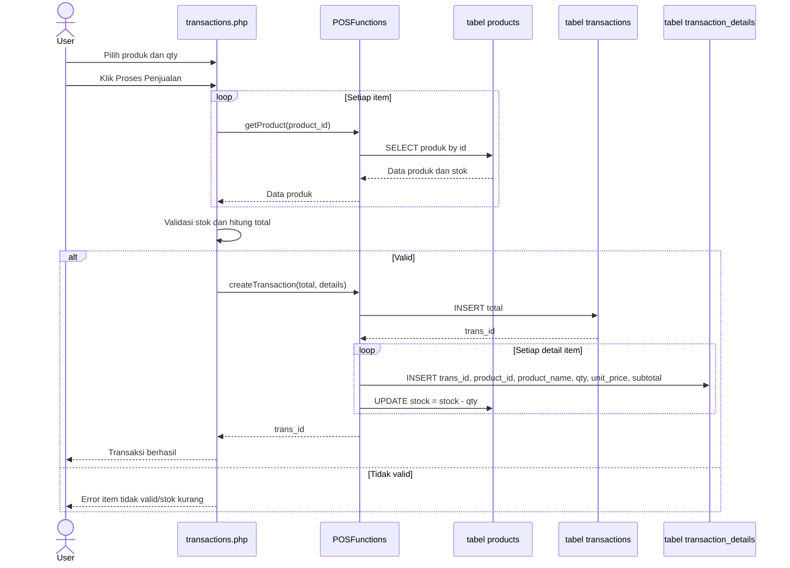

### Sequence Diagram Cetak Nota

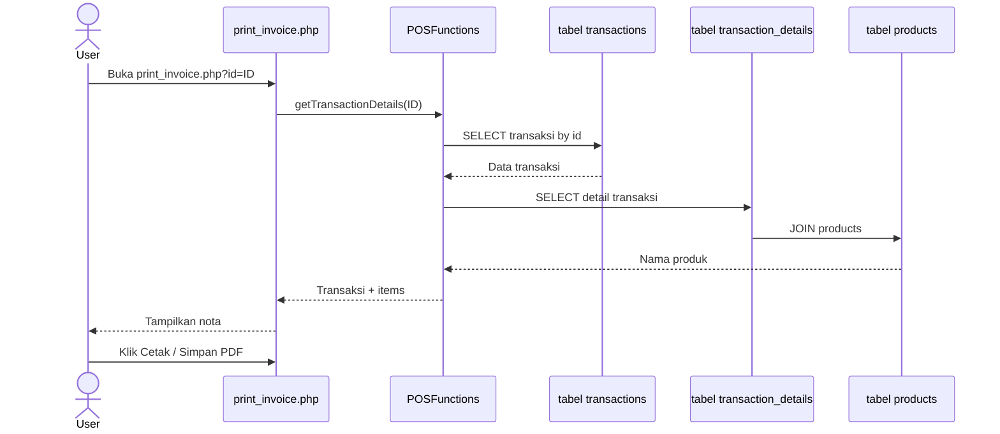

### Sequence Diagram Kelola User

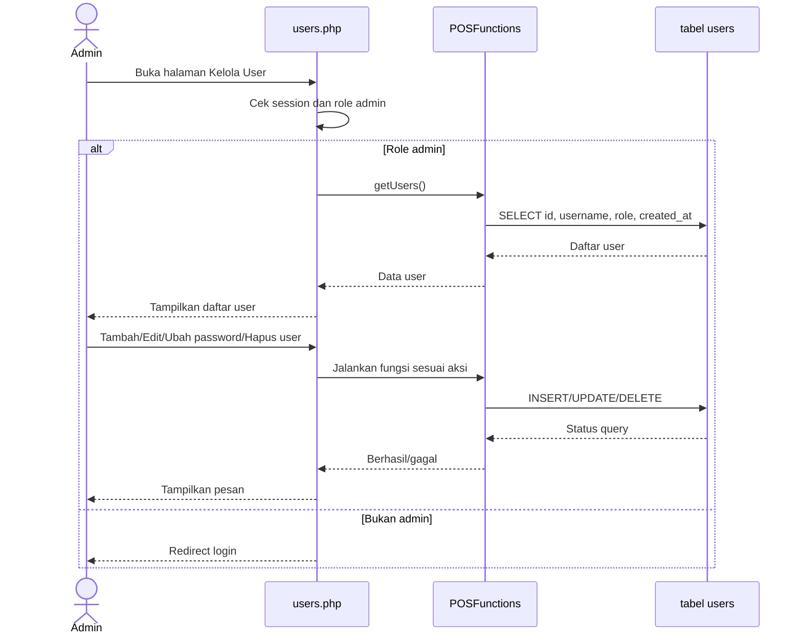

## 7. Penjelasan Kode Apriori / Market Basket Analysis

Pada halaman `reports.php` juga terdapat grafik top 10 barang terbanyak dibeli. Data grafik dihitung dari tabel `transaction_details` dengan menjumlahkan kolom `qty` per produk, lalu diurutkan dari jumlah pembelian terbesar.

Fungsi utama berada di `includes/functions.php`:

```php
public function getTopSoldProducts($limit = 10)
{
    $query = "
        SELECT
            COALESCE(td.product_name, p.name, 'Produk tidak tersedia') as product_name,
            SUM(td.qty) as total_qty,
            SUM(td.subtotal) as total_sales
        FROM transaction_details td
        LEFT JOIN products p ON td.product_id = p.id
        GROUP BY td.product_id, COALESCE(td.product_name, p.name, 'Produk tidak tersedia')
        ORDER BY total_qty DESC, total_sales DESC
        LIMIT :limit
    ";
}
```

Hasil fungsi tersebut digunakan oleh `reports.php` untuk menampilkan grafik batang dengan Chart.js dan tabel ringkas peringkat barang.

Pada sistem ini terdapat fitur analisis pasangan barang terlaris pada halaman `reports.php`. Fitur tersebut mengambil data dari tabel `transaction_details` untuk mencari dua produk yang paling sering dibeli dalam transaksi yang sama.

Secara konsep, fitur ini termasuk analisis market basket. Namun, kode yang ada belum menerapkan algoritma Apriori lengkap dengan nilai minimum support, confidence, dan lift. Implementasi saat ini adalah versi sederhana berupa pencarian frequent itemset ukuran 2, yaitu pasangan produk yang muncul bersama dalam satu transaksi.

### Lokasi Kode

Fungsi utama berada di `includes/functions.php`:

```php
public function getTopPairs($limit = 10)
{
    $query = "
        SELECT 
            CONCAT(p1.name, ' + ', p2.name) as pair,
            COUNT(*) as freq
        FROM transaction_details td1
        JOIN transaction_details td2 ON td1.trans_id = td2.trans_id AND td1.product_id < td2.product_id
        JOIN products p1 ON td1.product_id = p1.id
        JOIN products p2 ON td2.product_id = p2.id
        GROUP BY td1.product_id, td2.product_id
        ORDER BY freq DESC
        LIMIT :limit
    ";
    $stmt = $this->conn->prepare($query);
    $stmt->bindValue(':limit', $limit, PDO::PARAM_INT);
    $stmt->execute();
    return $stmt->fetchAll(PDO::FETCH_ASSOC);
}
```

Fungsi tersebut dipanggil pada `reports.php`:

```php
$pairs = $pos->getTopPairs(20);
```

Artinya, laporan akan menampilkan maksimal 20 pasangan produk dengan frekuensi pembelian bersama paling tinggi.

### Penjelasan Alur Kode

1. Sistem membaca data detail transaksi dari tabel `transaction_details`.
2. Tabel `transaction_details` digabung dengan dirinya sendiri menggunakan alias `td1` dan `td2`.
3. Kondisi `td1.trans_id = td2.trans_id` memastikan dua produk berasal dari transaksi yang sama.
4. Kondisi `td1.product_id < td2.product_id` digunakan agar pasangan tidak berulang. Contoh: pasangan `Pupuk + Bibit` hanya dihitung sekali, bukan dihitung lagi sebagai `Bibit + Pupuk`.
5. Sistem melakukan join ke tabel `products` untuk mengambil nama produk pertama dan produk kedua.
6. `GROUP BY td1.product_id, td2.product_id` mengelompokkan pasangan produk yang sama.
7. `COUNT(*) as freq` menghitung berapa kali pasangan tersebut muncul dalam transaksi.
8. `ORDER BY freq DESC` mengurutkan hasil dari pasangan yang paling sering muncul.
9. `LIMIT :limit` membatasi jumlah data yang ditampilkan.

### Arti Query SQL

Bagian query:

```sql
FROM transaction_details td1
JOIN transaction_details td2
    ON td1.trans_id = td2.trans_id
    AND td1.product_id < td2.product_id
```

Bagian ini membentuk kombinasi dua produk dalam transaksi yang sama. Misalnya terdapat transaksi:

| trans_id | product_id | Nama Produk |
|---|---|---|
| 1 | 2 | Pupuk Urea |
| 1 | 5 | Bibit Jagung |
| 1 | 7 | Pestisida |

Maka pasangan yang terbentuk:

| Pasangan Produk |
|---|
| Pupuk Urea + Bibit Jagung |
| Pupuk Urea + Pestisida |
| Bibit Jagung + Pestisida |

Jika pasangan tersebut muncul lagi pada transaksi lain, nilai `freq` akan bertambah.

### Output yang Dihasilkan

Fungsi `getTopPairs()` menghasilkan data seperti berikut:

| pair | freq |
|---|---:|
| Pupuk Urea + Bibit Jagung | 5 |
| Pestisida + Sprayer | 3 |
| Bibit Padi + Pupuk NPK | 2 |

Keterangan:
- `pair` adalah nama dua produk yang sering dibeli bersama.
- `freq` adalah jumlah kemunculan pasangan tersebut pada transaksi.

### Hubungan dengan Apriori

Algoritma Apriori biasanya memiliki tahapan:

1. Mengambil seluruh data transaksi.
2. Membentuk kandidat itemset 1 produk.
3. Menghitung support setiap item.
4. Menyaring item berdasarkan minimum support.
5. Membentuk kandidat itemset 2 produk atau lebih.
6. Menghitung support kombinasi produk.
7. Membentuk aturan asosiasi.
8. Menghitung confidence dan lift.

Kode pada sistem ini baru mencakup sebagian tahapan Apriori:

| Tahapan Apriori | Status pada Sistem |
|---|---|
| Membaca data transaksi | Ada |
| Membentuk kombinasi 2 produk | Ada |
| Menghitung frekuensi/support count | Ada |
| Minimum support | Belum ada |
| Confidence | Belum ada |
| Lift | Belum ada |
| Aturan asosiasi A => B | Belum ada |

Dengan kata lain, sistem sudah memiliki dasar market basket analysis, tetapi belum menjadi implementasi Apriori lengkap.

### Rumus yang Berkaitan

Frekuensi pasangan:

```text
freq(A, B) = jumlah transaksi yang berisi produk A dan produk B
```

Support pasangan:

```text
support(A, B) = freq(A, B) / total transaksi
```

Confidence aturan A => B:

```text
confidence(A => B) = freq(A, B) / freq(A)
```

Lift aturan A => B:

```text
lift(A => B) = confidence(A => B) / support(B)
```

Pada kode saat ini, sistem baru menghitung `freq(A, B)`.

### Contoh Interpretasi Hasil

Jika laporan menampilkan:

```text
Pupuk Urea + Bibit Jagung = 5x
```

Artinya, produk Pupuk Urea dan Bibit Jagung pernah dibeli bersama dalam 5 transaksi. Informasi ini dapat digunakan untuk:
- membuat rekomendasi produk tambahan saat kasir memilih produk tertentu,
- menyusun promo bundling,
- menata produk yang sering dibeli bersama agar berdekatan,
- membantu pemilik toko memahami pola pembelian pelanggan.

### Activity Diagram Analisis Market Basket

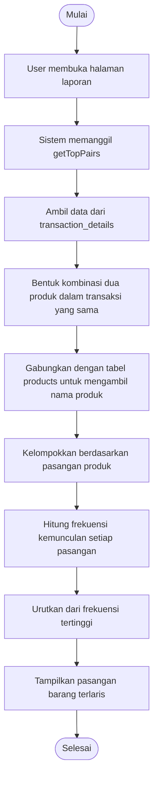

### Sequence Diagram Analisis Market Basket

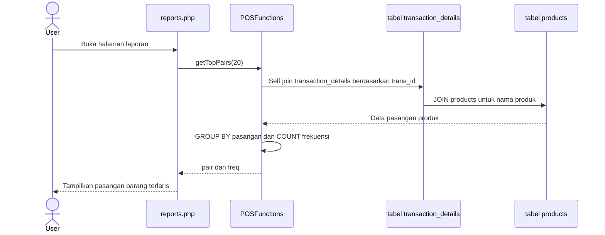

## 8. Struktur Tabel

Struktur berikut disusun dari query yang digunakan aplikasi. Tipe data dapat disesuaikan kembali dengan skema database aktual bila sudah tersedia.

### Tabel `users`

Fungsi: Menyimpan akun pengguna untuk login dan hak akses.

| Field | Tipe Data | Key | Keterangan |
|---|---|---|---|
| id | INT AUTO_INCREMENT | PK | ID user. |
| username | VARCHAR(100) | UNIQUE | Username untuk login. |
| password | VARCHAR(255) | | Password hasil hash `password_hash`. |
| role | ENUM('admin','pekerja') | | Hak akses user. |
| created_at | DATETIME / TIMESTAMP | | Waktu user dibuat. |

Contoh SQL:

```sql
CREATE TABLE users (
    id INT AUTO_INCREMENT PRIMARY KEY,
    username VARCHAR(100) NOT NULL UNIQUE,
    password VARCHAR(255) NOT NULL,
    role ENUM('admin', 'pekerja') NOT NULL DEFAULT 'pekerja',
    created_at TIMESTAMP DEFAULT CURRENT_TIMESTAMP
);
```

### Tabel `categories`

Fungsi: Menyimpan kategori produk.

| Field | Tipe Data | Key | Keterangan |
|---|---|---|---|
| id | INT AUTO_INCREMENT | PK | ID kategori. |
| name | VARCHAR(100) | | Nama kategori. |

Contoh SQL:

```sql
CREATE TABLE categories (
    id INT AUTO_INCREMENT PRIMARY KEY,
    name VARCHAR(100) NOT NULL
);
```

### Tabel `products`

Fungsi: Menyimpan data produk yang dijual.

| Field | Tipe Data | Key | Keterangan |
|---|---|---|---|
| id | INT AUTO_INCREMENT | PK | ID produk. |
| name | VARCHAR(150) | | Nama produk. |
| price | DECIMAL(12,2) | | Harga produk. |
| stock | INT | | Jumlah stok. |
| category_id | INT | FK | Relasi ke `categories.id`, boleh null. |

Contoh SQL:

```sql
CREATE TABLE products (
    id INT AUTO_INCREMENT PRIMARY KEY,
    name VARCHAR(150) NOT NULL,
    price DECIMAL(12,2) NOT NULL DEFAULT 0,
    stock INT NOT NULL DEFAULT 0,
    category_id INT NULL,
    CONSTRAINT fk_products_category
        FOREIGN KEY (category_id) REFERENCES categories(id)
        ON DELETE SET NULL
        ON UPDATE CASCADE
);
```

### Tabel `transactions`

Fungsi: Menyimpan header transaksi penjualan.

| Field | Tipe Data | Key | Keterangan |
|---|---|---|---|
| id | INT AUTO_INCREMENT | PK | ID transaksi. |
| total | DECIMAL(12,2) | | Total nilai transaksi. |
| trans_date | DATETIME / TIMESTAMP | | Tanggal dan waktu transaksi. |

Contoh SQL:

```sql
CREATE TABLE transactions (
    id INT AUTO_INCREMENT PRIMARY KEY,
    total DECIMAL(12,2) NOT NULL DEFAULT 0,
    trans_date TIMESTAMP DEFAULT CURRENT_TIMESTAMP
);
```

### Tabel `transaction_details`

Fungsi: Menyimpan detail item pada setiap transaksi.

| Field | Tipe Data | Key | Keterangan |
|---|---|---|---|
| id | INT AUTO_INCREMENT | PK | ID detail transaksi. |
| trans_id | INT | FK | Relasi ke `transactions.id`. |
| product_id | INT | FK | Relasi ke `products.id`. |
| product_name | VARCHAR(150) | | Snapshot nama produk saat transaksi dibuat. |
| qty | INT | | Jumlah produk yang dibeli. |
| unit_price | DECIMAL(12,2) | | Snapshot harga satuan saat transaksi dibuat. |
| subtotal | DECIMAL(12,2) | | Harga x qty. |

Contoh SQL:

```sql
CREATE TABLE transaction_details (
    id INT AUTO_INCREMENT PRIMARY KEY,
    trans_id INT NOT NULL,
    product_id INT NOT NULL,
    product_name VARCHAR(150) NULL,
    qty INT NOT NULL,
    unit_price DECIMAL(12,2) NOT NULL DEFAULT 0,
    subtotal DECIMAL(12,2) NOT NULL DEFAULT 0,
    CONSTRAINT fk_details_transaction
        FOREIGN KEY (trans_id) REFERENCES transactions(id)
        ON DELETE CASCADE
        ON UPDATE CASCADE,
    CONSTRAINT fk_details_product
        FOREIGN KEY (product_id) REFERENCES products(id)
        ON DELETE RESTRICT
        ON UPDATE CASCADE
);
```

## 9. Ringkasan Relasi Tabel

| Relasi | Kardinalitas | Keterangan |
|---|---|---|
| categories ke products | 1 : N | Satu kategori dapat digunakan banyak produk. |
| products ke transaction_details | 1 : N | Satu produk dapat muncul di banyak detail transaksi. |
| transactions ke transaction_details | 1 : N | Satu transaksi memiliki banyak item/detail. |

## 10. Modul dan File Terkait

| Modul | File | Keterangan |
|---|---|---|
| Koneksi database | `config/database.php` | Konfigurasi koneksi PDO ke database `audri_pos`. |
| Fungsi utama sistem | `includes/functions.php` | Berisi CRUD produk, kategori, transaksi, laporan, stok, dan user. |
| Login | `login.php` | Autentikasi user dan pembuatan session. |
| Logout | `logout.php` | Menghapus session. |
| Dashboard | `index.php` | Menampilkan stok kosong/habis dan tombol transaksi. |
| Produk dan kategori | `products.php` | Mengelola data produk dan kategori. |
| Transaksi | `transactions.php` | Memproses penjualan dan melihat transaksi terbaru. |
| Nota | `print_invoice.php` | Menampilkan dan mencetak nota transaksi. |
| Laporan | `reports.php` | Menampilkan laporan dan market basket analysis. |
| User | `users.php` | Mengelola akun pengguna khusus admin. |
